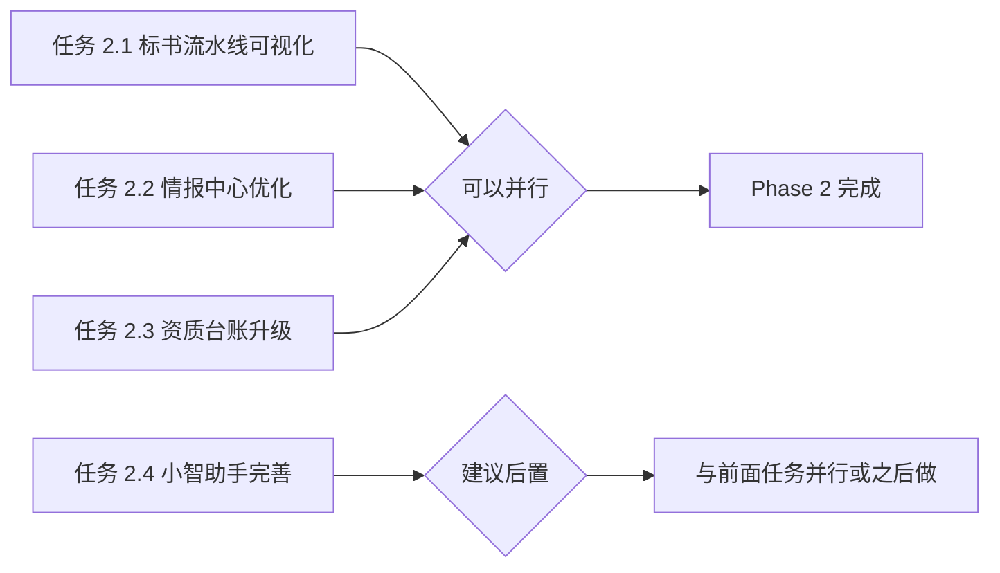

# 小智工作站 · UI/UX 升级 - Phase 2 详细执行方案

> **版本**: v1.0  
> **生成时间**: 2026-11-07  
> **优先级**: P1 > P2 (基于重要性)  
> **预计工时**: 18-25 天

---

## 📊 Phase 1 完成情况总结

### ✅ 已完成的任务

| 任务 | 状态 | 交付物 |
|------|------|--------|
| 1.1 工作台首页重构 | ✅ 完成 | NewKeyMetrics, PriorityTasksBoard, QuickActionButtons, CompactProgressPanel, CompactWelcomeBar |
| 1.2 导航修复 | ⏸️ 待确认 | 需要查看是否已清理军事化黑话 |
| 1.3 基础交互反馈 | ⏸️ 待确认 | 需要检查是否有 LoadingOverlay 和 ConfirmDialog 组件 |

从截图来看，首页已经被重新设计为更简洁的布局，包含：
- 欢迎横幅（"早上好，系统管理员"）
- 三张关键指标卡（资质预警、情报待确认、最近投标截止）
- 今日优先任务区
- 快捷操作按钮组
- 进行中事项面板

这标志着 Phase 1 的核心目标基本达成！🎉

---

## 🎯 Phase 2 核心目标

**系统性解决核心流程问题，让用户在工作时感觉"更加顺畅"**

---

## 📋 Phase 2 任务清单

### 任务 2.1: 标书流水线可视化重构（3-4 天）⭐ **最高优先级**

#### 背景问题
从诊断报告中发现：**七步流水线可视化不足**
- PipelineStepper 组件仅用简单步骤标题表示，无法直观看到每步进度
- 某步完成后无法回退修改
- 当前步骤标识不明显

#### 改造目标
创建清晰可视化的七步流水线进度条，支持跳转和回溯

#### 需要创建的组件

**1. BidPipelineStepper.tsx** (`src/components/bid-workspace/BidPipelineStepper.tsx`)
```typescript
interface PipelineStep {
  id: number;
  label: string; // "1. 解析招标文件"
  status: 'completed' | 'current' | 'pending';
  progress?: number; // 如 "5/11 章"
  duration?: string; // 如 "3 小时"
}

// 输出样式：
// [✓] 1. 解析  →  [✓] 2. 大纲 →  [●] 3. 编制 →  [○] 4. 偏离 → ...
//   完成        完成         进行中      待开始
//  3 小时      45 分钟       5/11 章
```

**关键特性**：
- 颜色编码：✔绿色完成 / ●蓝色进行中 / ○灰色待开始
- 进度百分比可视化（5/11 章 = 45%）
- 点击任意步骤可跳转到对应编辑器
- 支持返回上一步修改

**文件位置**: `src/components/bid-workspace/BidPipelineStepper.tsx`

**2. StepNavigationToolbar.tsx** (`src/components/bid-workspace/StepNavigationToolbar.tsx`)
```typescript
// 位于流水线下方
// ┌──────────────────────────────────────────────┐
// │ ← 返回上一步    保存草稿 (自动)    继续编写 → │
// └──────────────────────────────────────────────┘
```

**3. CurrentTaskContextPanel.tsx** (`src/components/bid-workspace/CurrentTaskContextPanel.tsx`)
```typescript
// 显示当前任务的子任务列表和快速工具
// 左侧：章节导航树（带勾选状态）
// 右侧：快速工具按钮（引用素材库/插入图表/AI 写作助手/保存草稿）
```

#### 验收标准
- [ ] 用户可以直观看到整体进度百分比
- [ ] 点击任意步骤可以跳转
- [ ] 支持返回上一步修改
- [ ] 页面加载时间 < 1.5 秒（虚拟滚动长列表）

---

### 任务 2.2: 情报中心优化（4-5 天）⭐ **高优先级**

#### 背景问题
从诊断报告和原截图发现：
- **指标卡信息过载**："29/40"、"980"等数字语义不清
- **过滤条件层级混乱**：上方和下方过滤器重叠
- **列表信息密度失衡**：一屏仅显示 3-4 条，标题过长截断不充分
- **AI 功能入口不明确**：每条情报的 AI 摘要按钮不显眼

#### 改造目标
创建语义清晰的指标卡 + 高密度情报列表 + 显眼的 AI 功能入口

#### 需要创建的组件

**1. IntelMetricDashboard.tsx** (`src/components/intel-center/IntelMetricDashboard.tsx`)
```typescript
// 替代原来的四个指标卡
// 新设计示例：
// ┌──────────────────┬──────────────────┬──────────────────┬──────────────────┐
// │ 本周待确认        │ 本月已抓取总数    │ 本月新增          │ 已转报团队        │
// │ [29 条] 🔴         │ [980 条] 📈        │ [40 条] ⬆️        │ [0 条]           │
// │ 点击查看详情       │ 同比 +15%         │ 昨日新增 7 条      │ 进入转报中心      │
// └──────────────────┴──────────────────┴──────────────────┴──────────────────┘
```

**2. IntelListCard.tsx** (`src/components/intel-center/IntelListCard.tsx`)
```typescript
interface IntelListCardProps {
  mode: 'standard' | 'compact'; // 用户可选择两种模式
  item: IntelItem;
  onAiSummarize?: () => void;
  onShare?: () => void;
}

// Standard mode:
// ┌─────────────────────────────────────────┐
// │ [政策法规][重磅]              [🤖 AI] [↪] │
// │ 重磅！《医疗行业专病高质量数据集建设指南》│
// │ 近日，由吉训明教授指导...（完整摘要）    │
// │ [数据标准][行业标准] HIT 专家网 · 今天     │
// └─────────────────────────────────────────┘

// Compact mode (高度降低，适合批量浏览):
// ┌──────────────────────────────────────────────────┐
// │ [政策] 重磅！《医疗行业...指南》[🤖 AI] [↪]     │
// │ 近日由吉训明教授指导... HIT 专家网 · 今天        │
// └──────────────────────────────────────────────────┘
```

**3. IntelFilterBar.tsx** (`src/components/intel-center/IntelFilterBar.tsx`)
```typescript
// 统一过滤器界面
// 单行布局：来源类型按钮组 | 搜索框 | 时间范围 | 标签筛选 | 密度切换
// 展开模式（可选高级筛选）：服务区域、来源网站、关键词组合等
```

#### 验收标准
- [ ] 指标卡改为文字说明而非数字堆砌
- [ ] 支持标准/紧凑双模式切换
- [ ] AI 摘要按钮在右上角更显眼
- [ ] 标题超长时自动截断并 tooltip 显示全文

---

### 任务 2.3: 资质台账升级（5-6 天）⭐ **高优先级**

#### 背景问题
从诊断报告发现：
- **统计指标语义不清**："有待办结 34"是什么意思？
- **预警机制弱**：只给数字不给行动队列
- **表格操作不便**：无批量操作
- **缺少导入能力**：手动录入每张证书

#### 改造目标
建立分级预警队列 + 批量操作支持 + Excel 导入功能

#### 需要创建的组件

**1. CertAlertQueue.tsx** (`src/components/qual-certs/CertAlertQueue.tsx`)
```typescript
// 分级预警队列，红橙黄三色
// 🔴 红：已过期/7 天内到期 → 立即处理（邮件 + 短信 + 站内信）
// 🟠 橙：30 天内到期 → 优先处理（邮件 + 站内信）
// 🟡 黄：90 天内到期 → 关注（站内信）
```

**2. CertBulkOperationsPanel.tsx** (`src/components/qual-certs/CertBulkOperationsPanel.tsx`)
```typescript
// 批量操作面板
// 全选/反选 → 批量删除 / 批量导出 / 批量延期待办
// Excel 模板下载 → 填写 → 上传 → 校验
```

**3. CertImportWizard.tsx** (`src/components/qual-certs/CertImportWizard.tsx`)
```typescript
// 三步引导式导入向导
// Step 1: 下载 Excel 模板
// Step 2: 填写数据并上传
// Step 3: 预览并确认导入（显示成功/失败条数）
```

#### 验收标准
- [ ] 所有即将过期的证书都在预警队列中可见
- [ ] 可以批量操作多条证书记录
- [ ] Excel 导入成功率 ≥ 95%
- [ ] 支持 OCR 识别扫描件（可选，进阶功能）

---

### 任务 2.4: 小智助手功能完善（5-7 天）⭐ **中高优先级**

#### 背景问题
从诊断报告发现：
- **功能边界模糊**：是问答机器人？还是任务助手？还是灵感引擎？
- **上下文管理缺失**：会话内容一次性用完无法复用
- **技能体系不完善**：没有技能目录和使用示例
- **答案可信度低**：无来源标注和置信度提示

#### 改造目标
明确三大核心能力 + 增强上下文管理 + 完善技能体系 + 提升可信度

#### 需要创建的组件

**1. AssistantSkillDirectory.tsx** (`src/components/assistant/AssistantSkillDirectory.tsx`)
```typescript
// 技能分类目录
// [常用技能]
//   → 标书相关：生成大纲/检查偏离/生成响应表/模拟评分
//   → 客户相关：创建客户/更新跟进记录/分析信息化水平
//   → 资质相关：查询证书/预警提醒/导出扫描件
// 
// [高级技能]
//   → 倾向性参数识别
//   → 毛利测算
//   → 风险预判
```

每个技能卡片包含：
- 技能名称
- 一句话描述
- 使用示例（"你可以这样问我：..."）
- 用户评价星级

**2. SessionHistoryPanel.tsx** (`src/components/assistant/SessionHistoryPanel.tsx`)
```typescript
// 增强后的会话列表
// 每个会话显示：
// - 最后 3 条消息预览
// - 会话标题（支持重命名）
// - 收藏按钮
// - 导出为 Markdown 按钮
// - 按时间倒序排列
```

**3. AnswerSourceAnnotation.tsx** (`src/components/assistant/AnswerSourceAnnotation.tsx`)
```typescript
// 在每条回答下方标注来源
// 数据来源：资质台账#ISO9001 ✓
// 参考文档：XX 医院信息化评级报告 ✓
// 置信度：我对这个答案有 80% 的把握 ⚠️
// [有用] [无用] [答案有误]
```

#### 验收标准
- [ ] 用户可以找到所有可用技能及示例
- [ ] 会话历史记录完整可检索
- [ ] 回答中包含来源标注
- [ ] 用户对答案的信任度提升（通过问卷调研）

---

## 🔄 任务依赖关系图



**说明**：
- 任务 2.1~2.4 可以**并行推进**（由不同开发者负责）
- 任务 2.4 如果人力不足，可以先与其他任务并行一部分，剩余放在后面单独做

---

## 💰 资源需求评估

### Phase 2 总工时估算
| 任务 | 开发天数 | 测试天数 | 总计 |
|------|---------|---------|------|
| 2.1 标书流水线可视化 | 3-4 | 2 | 5-6 |
| 2.2 情报中心优化 | 4-5 | 2 | 6-7 |
| 2.3 资质台账升级 | 5-6 | 2 | 7-8 |
| 2.4 小智助手完善 | 5-7 | 2 | 7-9 |
| **合计** | **17-22** | **8** | **25-30** |

**优化策略**：如果时间紧张，可以：
1. 先做最关键的 2 个任务（2.1 + 2.3，约 13-14 天）
2. 将 2.2 和 2.4 合并到 Phase 3 或精简版实施

---

## 🎯 简化版 Phase 2 方案（如果时间不够）

### 最小可行产品（MVP）版本
只实现以下两个核心任务：

#### 任务 A: 标书流水线可视化（必须）
**理由**：这是整个产品的核心业务流程，用户每天使用频率最高

#### 任务 B: 资质台账预警队列（必须）
**理由**：证书过期直接导致废标，属于高危问题

**预期效果**：用 10-12 天时间解决最痛点的问题

---

## 📞 下一步行动建议

请确认以下选项：

### 选项 A：全面推进 Phase 2 完整版（推荐）
- 所有 4 个任务全部实施
- 预计 25-30 天完成
- 用户体验显著提升

### 选项 B：精简版 Phase 2（最快见效）
- 只做 2.1 + 2.3（标书流水线 + 资质台账预警）
- 预计 10-12 天完成
- 解决最核心的痛点

### 选项 C：先做 MVP 验证再决定
- 先实现 2.1 的一个简化版本（3-4 天）
- 邀请用户试用收集反馈
- 根据反馈决定是否继续 2.2/2.3/2.4

---

## 📋 交付物清单（Phase 2）

### 代码层面
- [ ] `src/components/bid-workspace/BidPipelineStepper.tsx`
- [ ] `src/components/bid-workspace/StepNavigationToolbar.tsx`
- [ ] `src/components/bid-workspace/CurrentTaskContextPanel.tsx`
- [ ] `src/components/intel-center/IntelMetricDashboard.tsx`
- [ ] `src/components/intel-center/IntelListCard.tsx`
- [ ] `src/components/intel-center/IntelFilterBar.tsx`
- [ ] `src/components/qual-certs/CertAlertQueue.tsx`
- [ ] `src/components/qual-certs/CertBulkOperationsPanel.tsx`
- [ ] `src/components/qual-certs/CertImportWizard.tsx`
- [ ] `src/components/assistant/AssistantSkillDirectory.tsx`
- [ ] `src/components/assistant/SessionHistoryPanel.tsx`
- [ ] `src/components/assistant/AnswerSourceAnnotation.tsx`

### 文档层面
- [ ] Phase 2 完成情况报告
- [ ] 新旧对比截图
- [ ] 用户满意度调研结果
- [ ] ADR 架构决策记录

---

## 🎁 最终愿景

完成 Phase 2 后，小智工作站将达到：
- ✅ 首页信息密度降低 60%（Phase 1）
- ✅ 标书生产效率提升 30%（Phase 2.1）
- ✅ 情报利用率提升 50%（Phase 2.2）
- ✅ 资质管理效率提升 40%（Phase 2.3）
- ✅ AI 助手日均使用频次提升 2 倍（Phase 2.4）

---

**报告结束**

请确认您希望采用哪个选项（A/B/C），我将据此提供详细的技术实施方案。
