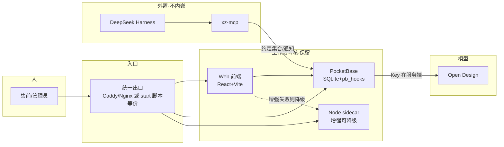

# D3 · 目标架构（C4 增量 · 2026-11）

> 状态：**已设计冻结**（上盛经兄嘚，2026-11-05 16:23）  
> 日期：2026-11-05（Asia/Shanghai）  
> 依据：D0 已确认；D1/D2 草稿；复用 `docs/refactor/02-SDD` §1–§3、§9（补充不整抄）；`code_analysis.md`；冒烟事实。  
> **零业务代码**；包 1–3 设计冻结前不动；账号隔离标「以后」；保留现栈 Web+PB+sidecar；Harness 外置+MCP。

---

## 给你的拍板要点（请逐条回：同意 / 改成… / 不做）

1. **目标形态一句话**：继续「浏览器 → Vite/静态托管 → PocketBase（含模型网关）→ Node sidecar」；加一层**统一出口**（反向代理）解决同事用不了 sidecar；**不**另起第二套业务后端。
2. **身份**：本阶段保持现有「业务身份 `local-user` + 团队角色壳」；架构图画占位「以后 → PB 原生 auth / 行级归属」。**本轮不落地账号隔离**（D0）。
3. **模型通道**：工作站 AI **只走 Open Design**（Key 在 PB hook）；「平台内置 gpt-5.5」本地不可用——UI 须标明不可用，不得假装是默认可用通道。
4. **Harness 边界**：Harness 永远外置；经 xz-mcp 读写约定集合 + 通知表；**不**内嵌进工作站进程；记忆/微信推送属后续期。
5. **情报与长任务**：目标态改为「服务端/计划任务可跑」；本文件只定边界，实现排进 D5 阶段 2/3。
6. **D3 通过后**：D4/D5 按本图排产品与里程碑；任何「换底座/换语言」视为改 D0/D2。

---

## 1. 本文件怎么用旧 SDD

| 旧文 | 本轮关系 |
|---|---|
| SDD §1 C4 上下文/容器 | **补充**：加上 sidecar 统一出口、Harness、Open Design 通道；部署从「dev 直开」演进到「可 build + 反代」 |
| SDD §2 前端分层 / ADR | **保留**：巨型 hook、无全局状态库、懒加载红线不变 |
| SDD §3 PB / 集合 / 路由 | **保留引擎**；身份与 IDOR 目标态标「以后」 |
| SDD §4 模型网关 | **补充**：本地默认通道锁定 Open Design；超时/失败可感知属实现，见 D5 |
| SDD §9 安全 | **补充不落地**：身份可伪造仍标高危，修复排「以后」 |

---

## 2. 现状 vs 目标（系统上下文 · C4 L1 文字）

### 2.1 现状（一句话）

售前在浏览器打开本机/局域网 `8000`，页面经 Vite 代理打到本机 `7000` PocketBase；大文档/生图打本机 `7001` sidecar（地址常写死 127.0.0.1，**同事浏览器打自己电脑**）。AI 经 PB 模型网关转发 OpenAI 兼容接口；本地「平台内置 gpt-5.5」常 412。Harness 已装本机，经 MCP 插件碰工作站数据。无账号隔离。

### 2.2 目标（一句话）

同一业务内核；浏览器只认**一个入口**（反代或等价统一出口）；PB 与 sidecar 均不直接暴露给同事；AI 通道对用户可见且可失败提示；Harness 仍外置。身份隔离画在图上，**实现以后**。



---

## 3. 容器图（C4 L2）· 边界表

| 容器 | 端口/入口（现状 → 目标） | 职责 | 本阶段改不改 |
|---|---|---|---|
| Web 前端 | `:8000` Vite dev → 目标可 `vite build` + 静态托管 | 17 路由业务 UI、浏览器导出 | 冻结前不改业务；冻结后按 D5 止血 |
| PocketBase | `:7000` 仅本机 → 目标经统一出口 | 集合、CRUD、模型网关、团队角色 | 引擎保留；身份落地「以后」 |
| Node sidecar | `:7001` 写死 127.0.0.1 → 目标经统一出口/可配置基址 | LibreOffice/大文档/AnyTXT/生图；**不碰库** | 先修可达（部署壳），再谈情报服务化 |
| Open Design | 外网 HTTPS | 工作站主模型通道 | 约定保留；密钥不进文档 |
| Harness + xz-mcp | 本机 Harness 进程 | 外置助手；读写约定 4 集合 + 通知 | 已接入；记忆/推送以后 |
| 统一出口 | **现状缺失** → 目标新增 | 同源入口、sidecar 对同事可达、收敛暴露面 | D5 阶段 2 |

### 3.1 身份边界（现状 / 目标 / 以后）

| 项 | 现状 | 目标态（设计承认） | 本轮实现 |
|---|---|---|---|
| 业务身份 | 固定 `local-user` + 头 `X-Rh-User-Id` | PB 原生 auth uid；服务端校验归属 | **以后** |
| 团队角色 | admin/editor/viewer 壳 | 与 uid 绑定 | 壳可留；数据隔离以后 |
| xz-mcp 鉴权 | 本机信任 | 与工作站身份对齐 | **以后** |
| 个人模型/记忆 | 挂 local-user，全员可见 | 按 uid | **以后** |

### 3.2 模型网关边界

```
页面 → modelGateway.ts → /__pb/api/model-gw/* → pb_hooks（持有 Key）→ Open Design（默认）
                                         ↘ 其他 OpenAI 兼容（用户自配）
「平台内置 gpt-5.5」→ /api/llm/* → 需 RunningHub：本地标为不可用，不作为默认成功路径
```

约束写入实现（D5）：超时/503 文案必须可理解；禁止推荐用户未配置的模型名。

### 3.3 Sidecar 边界

- **是**：增强层；失败可降级回浏览器路径。  
- **不是**：第二数据库；不持有模型主 Key；不替代 PB 鉴权。  
- **目标修复点**：客户端基址可配置 / 经统一出口，避免同事打自己的 `127.0.0.1:7001`。

### 3.4 Harness 边界

| 允许 | 禁止 |
|---|---|
| 外置进程 + MCP stdio/HTTP | 把 Harness 嵌进 Vite/Electron 壳 |
| 约定集合读写 + 确认码写回 | 插件静默删数据、绕过确认码 |
| 结果进工作站通知表（已有） | 本阶段强绑微信推送（第 3 期另议） |
| **阶段 1 起：按 S1 开工包主改本机仓业务代码**（上盛口令后） | 无开工令乱改；与「小智工作站」Bot **并行**改同一仓 |
| 工作站 AI 推理走 Open Design | 把 Open Design 当作改码通道 |

---

## 4. 关键数据归属（标「以后」处不展开实现）

| 数据 | 现状归属 | 设计目标 | 实现窗口 |
|---|---|---|---|
| 方案/标书/报价/客户 | 共用 `local-user` | 行级 uid + 项目协作者 | **以后** |
| 助手记忆 / 「个人」模型 | 同池 | 按 uid | **以后** |
| 知识库 personal 标记 | 仅前端过滤 | 服务端过滤 | **以后** |
| 通知表（xz） | 已建集合 | 保留；权限随身份演进 | 已有结构 |

---

## 5. 部署演进（与 D5 对齐的架构观点）

| 阶段 | 形态 | 架构含义 |
|---|---|---|
| 现在 | `start-local`：PB + Vite **dev** + sidecar 督导 | 能用；同事 sidecar 常失效 |
| 阶段 2（部署壳） | build 静态 + 统一出口；sidecar/PB 只经出口 | 小团队局域网「能共用增强层」 |
| 以后 | HTTPS、审计、身份落地 | 不改变「单团队本地/局域网」产品定位 |

**明确**：不做多租户公网 SaaS 部署拓扑。

---

## 6. 与 17 路由的关系（点名，不改壳）

路由真源 `routeRegistry.ts` 现有 17 条，本架构**不增不删路由**作为前提：

`/` · `/intel-center` · `/ai-hot` · `/customer-management` · `/solution-studio` · `/product-mapping` · `/ppt-quote` · `/materials` · `/bid-workspace` · `/bid-check` · `/format-tool` · `/knowledge` · `/qual-certs` · `/competitors` · `/assistant` · `/model-config` · `/team`

导航分组见 D6；半残修在页面内能力，不靠拆路由救命。

---

## 7. 明确不做（本文件）

1. 不画第二套业务后端替换 PB。  
2. 不把 Python/Go 升为主业务运行时（工具侧车按需另议，D2）。  
3. 不内嵌 Harness；不做站内 IM。  
4. 本文件不批准账号隔离落地编码。  
5. 不因架构图提前改 `useBidWorkspace` 等业务实现。

---

## 8. 对后续开发的含义

| 文档/阶段 | 含义 |
|---|---|
| D4 | 主链路与模块优先级必须能映射到本图容器 |
| D5 | 阶段 1=现栈止血；阶段 2=统一出口/sidecar 可达；阶段 3=情报服务化等平台；身份=以后 |
| 实现红线 | Key 只在服务端；sidecar 可降级；业务改码单通道 **Harness**；Open Design 仅模型 |

---

## 修订记录

| 时间 | 变更 |
|---|---|
| 2026-11-05 | 首稿，纳入一次交齐包 |

| 2026-11-05 16:23 | 设计冻结；Harness 改码边界与红线修订 |
