# 小智工作站 · 全站视觉走查与逐页优化方案

> **版本**: v1.0  
> **走查时间**: 2026-11-07  
> **覆盖范围**: 全部 17 个模块（实机截图走查，非源码推测）  
> **阅读方式**: 每个模块按「现状 → 为什么要优化 → 优化方向 → 优化后的结果」四段式呈现

---

## 〇、先讲全局：这个产品的"视觉基因"问题

在逐页分析前，必须先说清四个**贯穿全站**的根因问题——后面每一页的具体问题，几乎都能追溯到这四条：

### 全局问题 1：没有真正的设计系统，只有"Tailwind 惯性"

全站的视觉语言是「浅灰底 + 白卡片 + 蓝色点缀」的 Tailwind 默认审美。这导致：
- **层级扁平**：页面标题 24px、卡片标题 16px、正文 14px、辅助 12px——四档字号的对比度太接近，用户的眼睛找不到落点
- **色彩无语义**：成功/警告/危险几乎只靠小图标或小色点区分，大面积色块全是灰白蓝，重要信息（如"证书已过期"）视觉上和普通信息一样"安静"
- **间距漂移**：8/12/16/20/24px 在不同页面混用，没有节奏感

**为什么要优化**：B 端工具的视觉不是"好不好看"的问题，而是**信息检索效率**的问题。售前每天要在系统里找"哪个标快到期了""哪份证书要作废了"，视觉层级每弱一分，漏看风险就多一分。

### 全局问题 2：每个页面都在"重新发明布局"

走查 17 个页面后发现至少存在 **5 种页面骨架**：
1. 顶部统计卡 + 下方列表（客户管理、资质台账）
2. 左侧树 + 右侧内容（知识库、方案工作室）
3. 顶部大标题 + 描述 + 上传区（产品映射、标书检查）
4. 左右分栏对话式（小智助手）
5. 顶部指标 + 图表 + 列表（竞品分析、情报中心）

**为什么要优化**：用户每换一个页面都要重新适应一次布局，认知成本被放大。成熟的做法是收敛成 2-3 种骨架：**仪表盘型**（总览类）、**主从型**（列表+详情）、**任务流型**（向导/步骤）。

### 全局问题 3：操作反馈链路不完整

全站大量存在的模式：点击按钮 → 没有 loading → 没有成功提示 → 用户不确定操作是否生效。尤其是异步 AI 操作（生成大纲、AI 摘要），用户唯一能做的就是"等"。

**为什么要优化**：售前工作高度依赖 AI 生成，一次生成可能 30 秒到 3 分钟。没有进度反馈 = 用户反复点击 = 重复消耗 token = 成本浪费 + 结果混乱。

### 全局问题 4：空状态是"死路"

多个页面（素材库、PPT 与报价、我的项目跟进清单）空态只有一句"还没有 XX"，**没有给出下一步动作**。空状态本该是最佳的新手引导位，现在全部浪费。

---

## 一、工作台总览（首页）

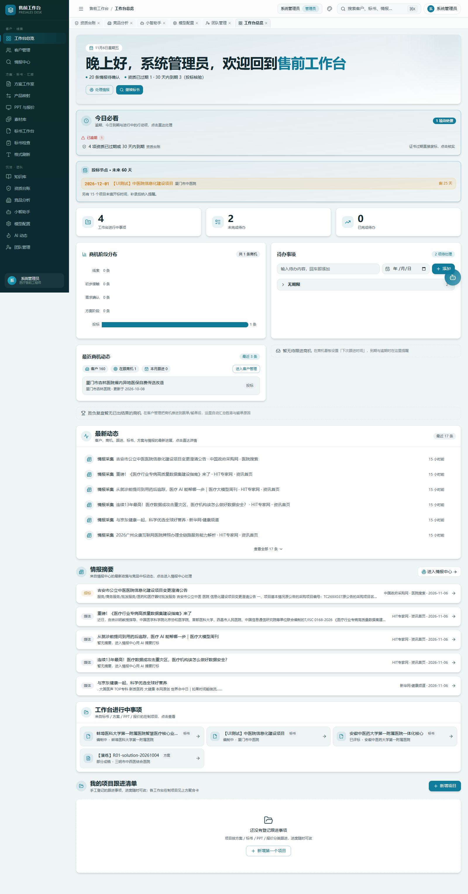

### 现状是什么样

整页高度约 **2958px**（需滚动 4 屏），自上而下堆叠了：欢迎横幅 → 今日必看 → 投标节点 → 3 个统计数字 → 商机分布图+待办 → 最近商机动态+待跟进商机 → 胜负复盘 → 最新动态（17 条情报）→ 情报摘要（5 条）→ 进行中事项 → 我的项目跟进清单，共 **14 个区块**。

### 为什么要优化

**从流程角度**：首页应该是"上班第一站"——回答用户三个问题：*今天有什么必须处理的？我正在做的事进展如何？我接下来点哪里？* 现状是三个问题都没答好：
- "今日必看"里只放了资质预警一条，情报、标书节点、待办散落在下方各个角落
- "进行中事项"被压到第 5 屏，用户最常用的东西位置最深
- 大量区块（商机分布、胜负复盘）在无数据时呈现"共 0 条商机"的空转状态，**占了黄金位置却提供零价值**

**从布局角度**：
- 首屏被欢迎横幅占掉近 1/4 高度——它对老用户是零信息量的装饰
- "最新动态"和"情报摘要"两个区块内容高度重叠（都在展示情报流），用户分不清差异
- 3 个统计卡（进行中事项 0 / 未完成待办 2 / 已完成待办 0）信息密度极低，一个数字配一行字占了一整卡

**从视觉角度**：所有卡片同权重、同圆角、同阴影，扫视时没有视觉锚点，眼睛不知道先看哪里。

### 优化方向

1. **砍**：14 个区块收敛为 5 个——欢迎条（压扁成一行）→ 关键预警指标（3 卡）→ 今日优先任务（3 张任务卡）→ 快捷操作（4 入口）→ 进行中事项（双栏）。整页控制在 1200px 内一屏半
2. **排**：引入优先级排序算法（截止时间 × 阻塞程度 × 本人负责），让"最该做的事"永远排第一
3. **藏**：无数据的区块（商机分布、胜负复盘）自动折叠为"暂无数据"的一行提示，不再占位
4. **合**："最新动态"与"情报摘要"合并为一个信息流

### 优化后的结果

> ✅ **已完成**（Phase 1 已上线，见实际效果）：首页高度从 2958px 降到约 1000px，首屏直接呈现 3 张预警指标卡（资质预警 4 项 / 情报待确认 20 条 / 最近投标截止）+ 今日优先任务 + 快捷操作 + 进行中事项。用户打开页面 3 秒内即可回答"今天该干什么"。

---

## 二、客户管理

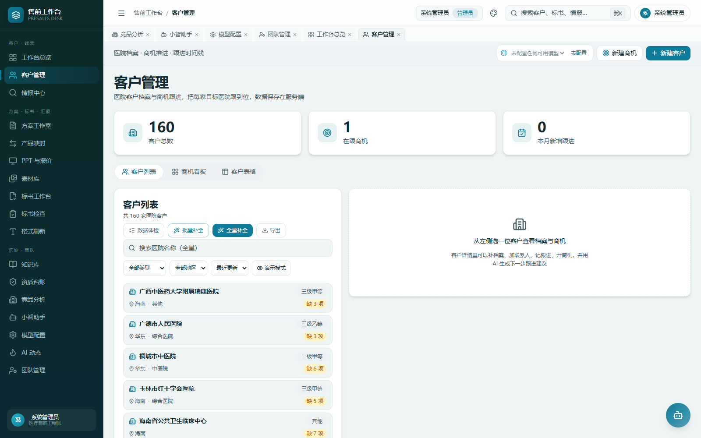

### 现状是什么样

顶部三张统计卡（客户总数 160 / 在跟商机 1 / 本月新增跟进 0）→ 三个视图 Tab（客户列表/商机看板/客户表格）→ 左侧客户列表（带"缺 N 项"黄色角标）+ 右侧大面积空白的详情占位区。

### 为什么要优化

**从流程角度**：售前在客户管理的核心流程是 *找客户 → 看画像 → 补资料 → 推商机*。现状的断点：
- 顶部横幅"未配置任何可用模型 ⚠ 去配置"永久占着一行——模型配置是**系统级设置**，不该在业务页面顶部常驻打扰
- "缺 3 项 / 缺 6 项"角标很有价值（提示档案不完整），但**点击它没有反应**，用户不知道缺的是哪 3 项、去哪补——一个有潜力的功能死在了最后一公里
- 右侧详情区在未选中客户时是一整块空白 + 居中小图标，1600px 宽的屏幕一半面积在显示"请从左侧选择"——**首屏 50% 面积被浪费**

**从布局角度**：左侧列表宽度约 45%，每个客户卡片只有名称+地区+等级+缺失数，信息密度偏低；列表没有按"最近跟进"排序的显性提示。

**从操作角度**：「数据体检 / 批量补全 / 全量补全 / 导出」四个按钮并列，但"批量补全"和"全量补全"的区别没有任何说明——用户不敢点，因为不知道点下去会发生什么（这正是需要二次确认+预览的场景）。

### 优化方向

1. **默认展示第一位客户的详情**，或默认展示"客户健康度总览"面板，消灭半屏空白
2. "缺 N 项"角标改为**可点击的弹层**：展开显示具体缺哪些字段，每项带"去补全"直达链接
3. 模型配置警告降级为**右上角小黄点**（仅未配置时出现一次，点击后不再骚扰）
4. 「批量补全/全量补全」增加 hover 说明气泡 + 执行前预览（将影响 N 家客户，预计耗时 X 分钟）
5. 列表增加**跟进热力标识**（🔥 30 天内有跟进 / ❄️ 超 90 天未跟进），让"该唤醒谁"一目了然

### 优化后的结果

用户打开客户管理，首屏即见"160 家客户中 32 家超 90 天未跟进"的 actionable 洞察；点击"缺 3 项"直接弹出缺失清单并逐项补全；首屏零浪费，操作路径从 4 步缩到 2 步。

---

## 三、情报中心

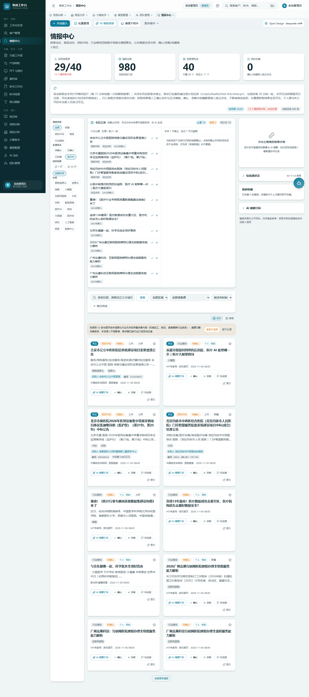

### 现状是什么样

整页高约 3600px。自上而下：手动录入/批量管理等工具行 → 指标区（29/40 待确认、980、40、0 四张卡）→ 一大段蓝色说明文字 → 左侧筛选面板（类别/状态/时间/标签等约 6 组筛选器）→ 中间「今日工作」清单 → 下方搜索框+筛选下拉 → 情报卡片流。

### 为什么要优化

**从流程角度**：情报处理的核心流程是 *抓取 → 确认 → 打标 → 转商机/转标书*。现状把流程拆散在了至少三个区域：
- "今日工作"待确认清单在页面中段
- 批量操作按钮在顶部
- 转商机入口藏在每条情报里

**用户要处理 20 条待确认情报，视线需要在 3600px 的页面里上下往返**。

**从布局角度**：这是全站信息密度失控最严重的页面：
- 顶部 4 张指标卡里，"29/40"这种分数式写法（已确认/总数）和"980""40""0"三个纯数字并列，语义完全不同却长得一样
- 大段蓝色说明文字（介绍数据源和抓取频率）属于**设置级信息**，永久占据首屏黄金位置
- 左侧筛选栏 + 中部筛选行**两级筛选并存**，用户不知道哪级生效

**从操作角度**：每条情报卡有「AI 摘要打标 / 确认 / 编辑 / 标重点 / 原文」5 个操作，平铺在一行——操作权重没有差异，最高频的"确认"和最低频的"编辑"长得一样。

### 优化方向

1. **双模式列表**：默认"审阅模式"（只看待确认，大卡片+一键确认按钮），切换到"浏览模式"（全部情报，紧凑列表）。把"处理"和"浏览"两种互斥的心智分开
2. 指标卡语义化："本周待确认 29 条 ▼较上周-15%"，可点击直达过滤视图
3. 蓝色说明文字收进"ⓘ 数据源说明"的折叠弹层
4. 筛选器合并为一行主筛选（类型/状态/时间）+ "高级筛选"抽屉
5. 操作分层：主操作「确认」做成实心按钮，其余收进 "⋯" 菜单

### 优化后的结果

处理 20 条待确认情报从"上下滚动 3 屏逐条找按钮"变为"固定列表逐条点确认"，预计处理时间缩短 50%；首屏从"说明书"变回"工作区"。

---

## 四、AI 动态

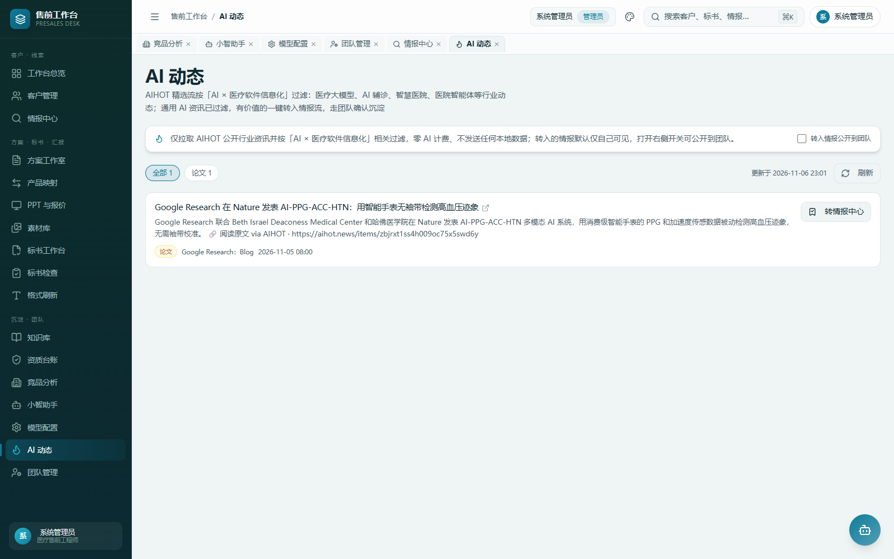

### 现状是什么样

页面上方一条说明横幅 → 全部 1 / 论文 1 的 Tab → 仅 1 条 Google Research 论文资讯 → 其余大片空白。

### 为什么要优化

**这是全站"投入产出比"最低的页面**。问题不在于 UI 细节，而在于**功能定位本身**：

- 内容源（AIHOT 通用 AI 资讯）与售前工作（医疗信息化投标）的相关性极低——"用智能手表检测高血压"这类内容对售前没有行动价值
- 一个只有 1 条内容的页面占用了左侧导航的一个黄金位置
- 右侧"转情报中心"的流转逻辑与情报中心重叠

**从布局角度**：内容区约 80% 是空白，页面却保留了完整的双行横幅 + Tab + 更新时间工具行——框架比内容重。

### 优化方向

**建议做减法而非加法**——两个选项：
- **选项 A（推荐）**：合并进情报中心，作为其一个"行业前沿"频道；从主导航移除
- **选项 B**：若保留独立页面，必须换内容源为"医疗信息化 AI 应用"（如电子病历 AI 评级、DRG 智能分组等），并增加订阅主题

### 优化后的结果

导航从 17 项减至 16 项；用户少一次无效点击；情报中心成为唯一的"信息入口"，心智更集中。

---

## 五、方案工作室

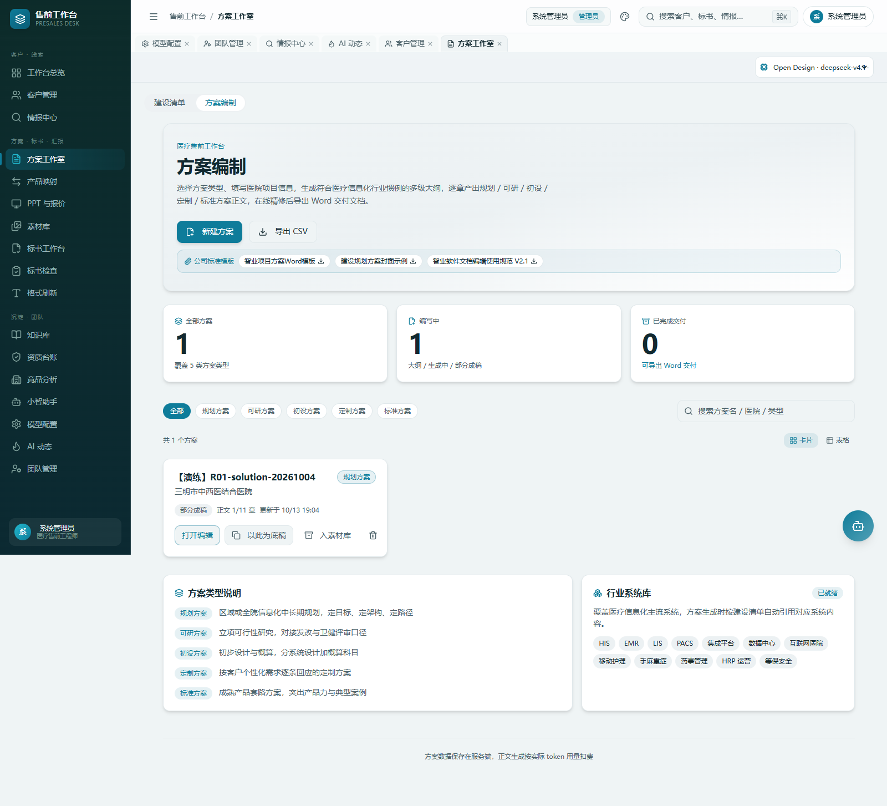

### 现状是什么样

顶部标签栏下方：建设清单/方案编制 两个 Tab → 大标题"方案编制"+ 说明 → 新建方案/导出 CSV → 模板下载条 → 三张统计卡（全部方案 1/编写中 1/已完成 0）→ 类型筛选片 + 搜索框 → 方案卡片 → 底部"方案类型说明"和"行业系统库"两个知识卡片。

### 为什么要优化

**从流程角度**：方案工作室是生产线之一，但**页面 60% 的篇幅给了"新手教学"**：
- 方案类型说明（规划/可研/初设/定制/标准的定义）
- 行业系统库（HIS/EMR/LIS/PACS 等 12 个系统标签）
- 模板下载条

这些信息对**第一次使用的人**很重要，但对每天使用的老用户是永久噪音。正确做法是首次引导时展示，之后收进帮助中心。

**从布局角度**：
- 三张统计卡（1/1/0）用三张等宽大卡装三个小数字，浪费约 200px 高度
- 方案卡片只有 1 张却独占整行，列表区显得空旷
- "医疗售前工作台"小标题和"方案编制"大标题之间没有面包屑关系，层级混乱

**从操作角度**：方案卡片上「打开编辑 / 以此为底稿 / 入素材库 / 删除」四个操作平铺，"删除"这种危险操作与"打开编辑"视觉权重相同。

### 优化方向

1. 统计卡压缩为一行数据条（全部 1 · 编写中 1 · 已完成 0，点击可过滤）
2. 教学信息默认折叠："📖 方案类型说明 ▾"，点击展开
3. 方案卡片操作分层：主按钮"打开编辑"，其余收 "⋯"
4. 空态引导化：当方案数为 0 时，展示"三步创建第一个方案"的引导卡而非空列表

### 优化后的结果

页面有效工作区面积增加约 40%；老用户不再被教学信息打扰；删除操作有明确的防误触。

---

## 六、产品映射

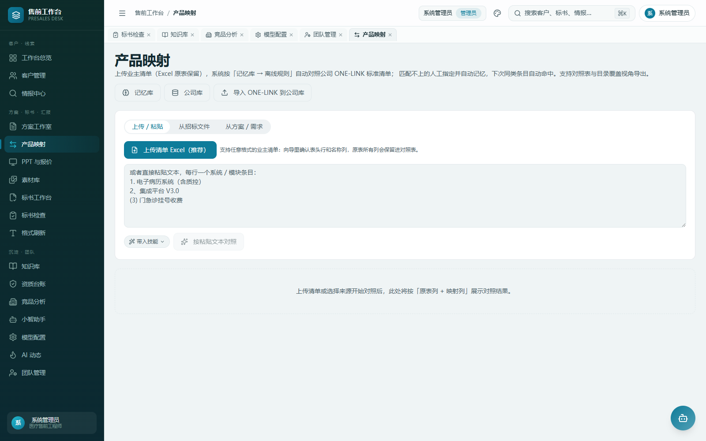

### 现状是什么样

大标题 + 功能说明（很长的一段）→ 三个 Tab（记忆库/公司库/导入 ONE-LINK）→ 三个来源 Tab（上传粘贴/从招标文件/从方案需求）→ 上传区 + 大段粘贴文本框 → 底部一行占位说明"上传清单后此处展示对照结果"。

### 为什么要优化

**从流程角度**：这是一个典型的**向导型任务**（上传清单 → 对照 → 导出结果），但页面把它平铺成了"杂货铺"：
- 两层 Tab（功能 Tab + 来源 Tab）叠加，用户分不清"记忆库/公司库"与"上传粘贴"的关系
- 上半屏全是输入区，下半屏一行小字说"结果会显示在这里"——**结果区没有任何视觉存在感**
- 页面 70% 是空白，但实际功能（对照结果表格）完全没出现

**从操作角度**：
- "上传清单 Excel（推荐）"按钮和下面的文本框是两种输入方式，但没有告诉用户"选一种就行"
- 文本框里的示例文本（"1.电子病历系统（含质控）"）是真实占位内容还是演示？用户分不清
- 「带入技能」「按粘贴文本对照」两个按钮用灰色小字，看起来像禁用状态

### 优化方向

1. 改为**明确的左右分栏**：左栏"输入区"（上传/粘贴/从历史选，三个来源卡片化并排），右栏"对照结果区"（未开始时显示 4 格示意图预览"结果长这样"）
2. 两层 Tab 合并：记忆库/公司库/导入 收进顶部工具行，页面主体只服务"对照"这一件事
3. 示例文本用占位符样式（灰色斜体 + "示例："前缀），并在文本框上方加"或"分隔符
4. 结果区未就绪时显示**骨架屏示意**，而不是一行小字

### 优化后的结果

用户首次进入即理解"左边进、右边出"；任务路径从"读说明书"变为"看图操作"；对照结果成为页面视觉主角。

---

## 七、PPT 与报价

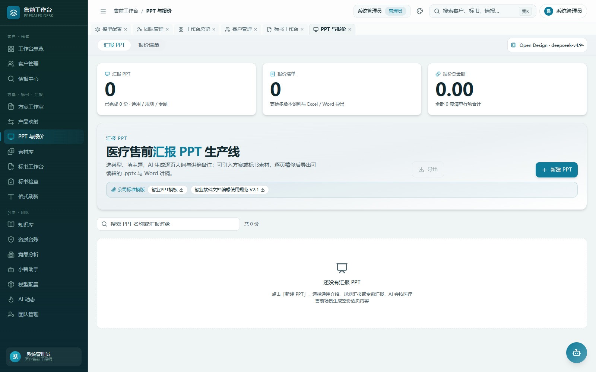

### 现状是什么样

汇报 PPT / 报价清单 两个 Tab → 三张统计卡（汇报 PPT 0 / 报价清单 0 / 报价总金额 0.00）→ "医疗售前汇报 PPT 生产线"大标题卡（含说明+模板下载+新建按钮）→ 搜索框 → "还没有汇报 PPT"空态。

### 为什么要优化

**从流程角度**：PPT 和报价是**两个独立业务**，被硬塞进一个页面的两个 Tab 里：
- 报价清单的统计卡（总金额 0.00）在"汇报 PPT"Tab 下依然显示——数据与上下文错位
- 用户在"报价清单"Tab 里看到的页面标题仍是"医疗售前汇报 PPT 生产线"——标题不随 Tab 切换

**从布局角度**：三张统计卡全为 0 时，传达的信息其实是"你还没用过这个功能"，但展示方式像三个"失败的指标"，给人负面暗示。

**从操作角度**："新建 PPT"按钮在右上角，位置正确；但空态区的引导语（"点击「新建 PPT」..."）是说明文字而非**可点击的主按钮**——用户要读完一段话再去找按钮。

### 优化方向

1. **Tab 与统计卡联动**：PPT Tab 只显示 PPT 相关指标，报价 Tab 显示金额/清单数
2. 空态增加**居中的主行动按钮**（"+ 创建第一个汇报 PPT"），比右上角按钮更显性
3. 报价 Tab 增加"最近报价单"快捷入口（售前高频动作是"改上次的报价"）
4. 考虑拆成两个独立导航项（中期方案）

### 优化后的结果

两个业务互不干扰；新用户在空态下一眼看到创建入口；报价修改路径缩短一步。

---

## 八、素材库

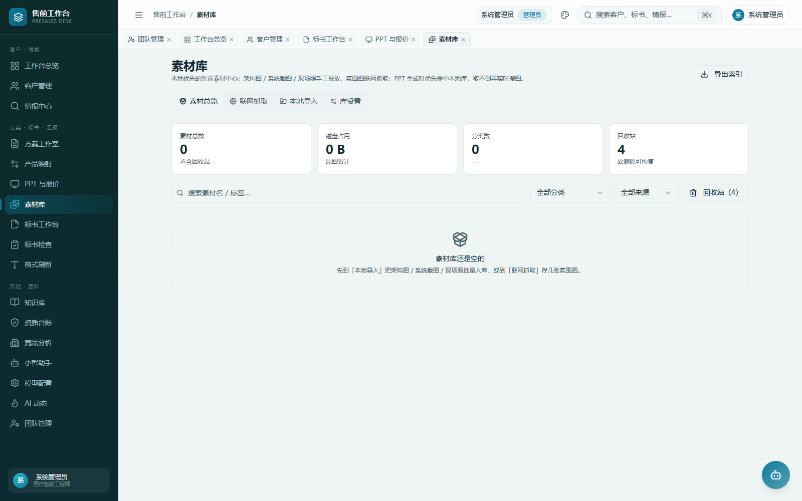

### 现状是什么样

顶部说明 → 四个 Tab（素材总览/联网抓取/本地导入/库设置）→ 四张统计卡（素材总数 0 / 磁盘占用 0B / 分类数 0 / 回收站 4）→ 搜索框 + 三个筛选 → "素材库还是空的"空态。

### 为什么要优化

**从流程角度**：素材库的定位是"PPT 生成时优先命中本地库"，也就是说**它的价值在使用端（PPT 编辑器），而不是管理端**。当前页面是一个纯粹的管理界面，但它暴露的问题：
- "回收站 4"：库里是空的但回收站有 4 个素材——**这对用户是困惑而非信息**（说明有删除行为但没有有效积累）
- "联网抓取"作为一个 Tab 与"素材总览"并列——抓取是**动作**不是**视图**，应该是按钮而非 Tab

**从布局角度**：四张统计卡三个为 0，和一个为 4 的回收站并列，视觉上非常怪异。空态文案不错（指出了两条入库路径），但两条路径（本地导入/联网抓取）只是文字提及，不是可点按钮。

### 优化方向

1. 统计卡精简为两张（素材总数 / 回收站），回收站为 0 时隐藏
2. Tab 收敛为"素材总览"一个视图，「本地导入」「联网抓取」改为右上角两个动作按钮
3. 空态文案中的两条路径变成**两个实体按钮卡片**（📁 本地导入 / 🌐 联网抓取）
4. 增加"素材使用排行"区块（被 PPT 引用次数 Top 10），让素材库的价值可见

### 优化后的结果

管理界面从 4 Tab 降为单视图；空库时的引导路径可点击直达；素材从"死库存"变为"可度量的资产"。

---

## 九、标书工作台（核心模块）

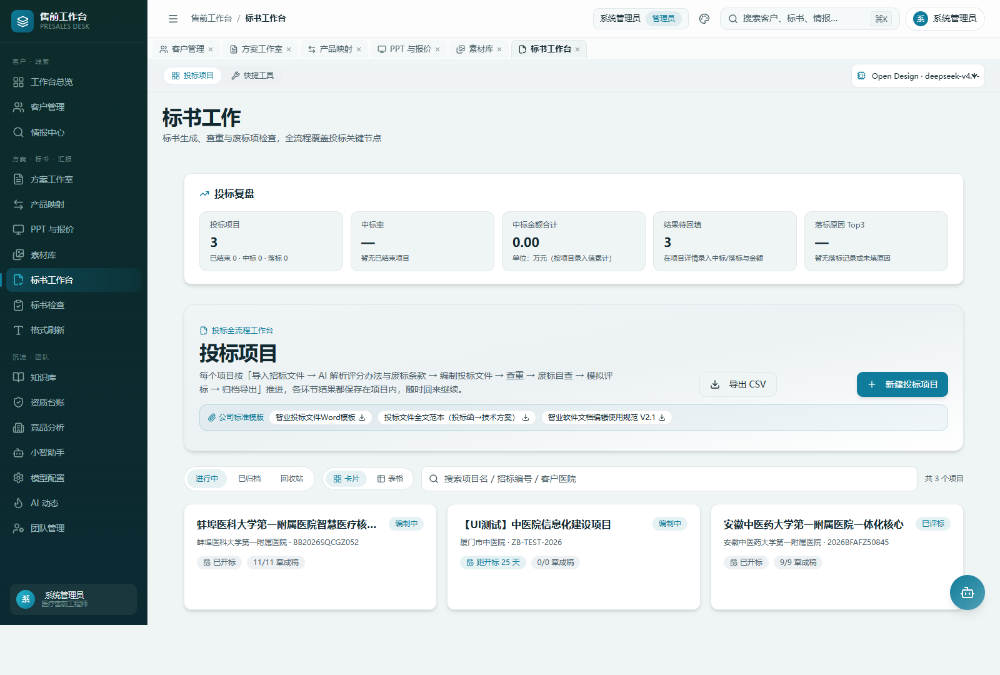

### 现状是什么样

大标题"标书工作" → 投标复盘卡（5 个统计：投标项目 3/中标率—/中标金额 0.00/结果待回填 3/废标原因 Top3 暂无）→ "投标全流程工作台"卡（说明 + 导出 CSV + 新建投标项目 + 模板下载条）→ 状态片（进行中/已归档/回收站）+ 卡片/表格切换 + 搜索 → 三张项目卡。

### 为什么要优化

**从流程角度**：这是全站的心脏，核心流程是七步流水线。问题在于**项目列表页和七步流水线之间是断裂的**：
- 项目卡片上只有"已开标/距开标 25 天"和"0/0 章成稿"，**没有显示项目处于七步中的哪一步**——用户必须点进去才知道该干什么
- "投标复盘"卡放在项目列表上方，但复盘数据（中标率）是全为空的——**空指标占据了最重要的位置**

**从布局角度**：
- 顶部"标书工作"大标题 + "投标全流程工作台"卡内的大字"投标项目"形成**双重标题**，层级冗余
- 项目卡片的"0/0 章成稿"对进行中项目是一个失败的进度表达（分母为 0 说明大纲还没生成，但用户读不出这层意思）

**从操作角度**：模板下载条（公司标准模板/智业投标文件 Word 模板等）是**全局资源**，却放在项目列表的卡片里，每次进来都占据一行。

### 优化方向

1. 项目卡片增加**七步进度微缩条**（7 个圆点，当前步骤高亮）——让用户在列表页就知道每个项目卡在哪一步
2. 投标复盘卡在无数据时整体折叠为一行提示（"暂无已结束项目，出结果后这里会生成复盘"）
3. 双重标题合并，模板下载收进"新建投标项目"的下拉菜单
4. "0/0 章"改为状态文案（"待生成大纲"/"编写中 5/11 章"）

### 优化后的结果

> ⚙️ **进行中**：Phase 2 任务 2.1 已完成项目内的流水线增强组件开发（进度可视化+步骤跳转+上下文面板），待集成验证。列表层的"七步进度微缩条"建议作为 2.1 的补充项一并实施。

项目列表从"项目名录"升级为"项目作战地图"——每个项目的卡点一目了然。

---

## 十、标书检查

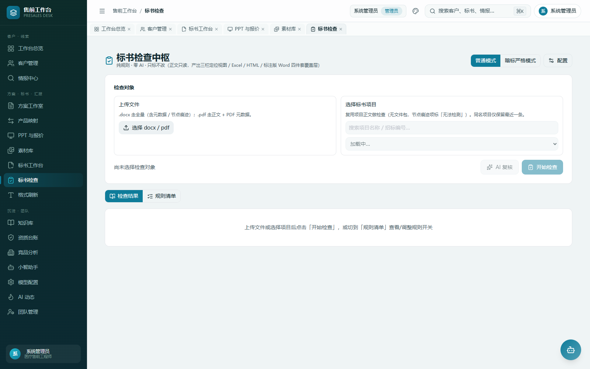

### 现状是什么样

标题"标书检查中枢" → 模式切换（普通模式/暗标严格模式/配置）→ 检查对象区（左：上传文件 docx/pdf；右：选择标书项目）→ AI 复核 + 开始检查按钮 → 下方"检查结果/规则清单"Tab + 一行引导文字。

### 为什么要优化

**从流程角度**：这是一个**工具型页面**，流程极简（给文件 → 检查 → 看报告），但现状把简单流程做复杂了：
- "上传文件"和"选择标书项目"是两个互斥的入口，用左右两个等宽大卡并列——用户要先想清楚"我的文件在哪"才能选对入口
- 「开始检查」按钮是灰色的（未选对象时禁用），但**没有用文案告诉用户"先选对象"**——按钮哑巴了
- 模式切换（普通/暗标严格）是重要选项，却用两个灰色按钮低调处理

**从布局角度**：下方 60% 区域只有一行引导文字，整个页面头重脚轻。

### 优化方向

1. 检查对象区改为**居中单一上传区**（支持拖入文件 OR 点击选择项目，一个大框两个入口）
2. 「开始检查」按钮旁常驻提示文字（"← 请先上传文件或选择项目"），禁用原因显形
3. 模式切换改为带说明的单选卡（普通模式=只读正文 / 暗标严格=全量含元数据，各配一行解释）
4. 下方空白区改为"最近检查报告"列表（直接打开历史报告）

### 优化后的结果

工具页回归极简：进来 → 拖文件 → 点检查，三步完成。历史报告可复访，检查结果不再是"一次性"的。

---

## 十一、格式刷新

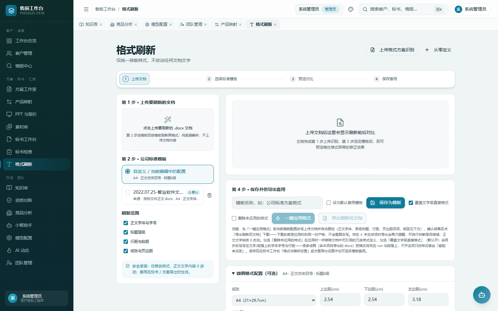

### 现状是什么样

顶部步骤条（1 上传文档 → 2 选择标准模板 → 3 预览对比 → 4 保存套用）→ 左栏（上传区+模板选择+刷新范围勾选项）→ 右栏（预览对比空态 + 保存套用区 + 微调格式配置区）。

### 为什么要优化

**这是全站布局最规范的页面之一**（步骤条清晰、左右分栏合理），但仍然有问题：

**从操作角度**：
- 右栏"第 4 步"区域出现了一整段**密集的小字说明**（约 200 字，讲述保存逻辑和覆盖规则）——关键安全说明被写成了"没人会读的长段落"
- "一键应用格式"和"导出刷新后文档"两个按钮的先后关系没有视觉暗示（先应用还是先导出？）
- 微调配置区（纸张/页边距）默认展开，抢占了预览区的视觉位置

**从布局角度**：预览区空态占了右栏一半面积却只放了一个图标+两行字。

### 优化方向

1. 长段安全说明改为 ⚠ 图标 + hover 展开，或改为**操作时的确认弹窗**（在点击"保存套用"时呈现）
2. 按钮加序号徽章（③ 一键应用 → ④ 导出文档），用视觉引导顺序
3. 微调配置区默认折叠
4. 预览区空态改为"刷新效果预览将在这里显示"+ 示意缩略图

### 优化后的结果

好底子不被浪费：关键安全提示在正确时机出现；操作顺序无歧义。

---

## 十二、知识库

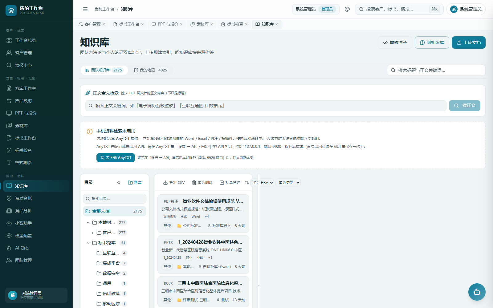

### 现状是什么样

标题 + 审核原子/问知识库/上传文档 三按钮 → 团队知识库 2175 / 我的笔记 4825 两个大 Tab → 正文全文检索框 → 黄色警告条（AnyTXT 未启用）→ 左目录树（全部文档/本地…/标书范本等层级）+ 右侧文档卡片流。

### 为什么要优化

**从流程角度**：知识库的两个核心动作是**找**（检索）和**存**（上传沉淀）。现状：
- 页面上有**两个搜索框**（顶部"搜索标题与正文关键词" + 中部"正文全文检索"），用户不知道用哪个、结果有何不同
- AnyTXT 未启用的黄色警告条占了很大面积，且文案极长（包含下载、端口、绑定等操作指引）——**设置问题不该打断检索主流程**

**从布局角度**：
- "2175 / 4825"两个大数字 Tab 视觉冲击强，但用户真正高频的动作是搜索和浏览目录树，数字没有行动价值
- 目录树的层级较窄（左侧仅约 20% 宽），长目录名被截断（"互联互…""集成平台"）

**从操作角度**：文档卡片上信息较杂（格式图标+标题+摘要+标签+来源+时间），缺少"最近在项目里被引用过"这种**高价值信号**。

### 优化方向

1. **搜索框合一**：一个大搜索框，结果分"标题命中/正文命中"两组展示
2. AnyTXT 警告压缩为一行可收起横幅，详细指引收进链接
3. 左侧目录树支持拖拽调宽
4. 文档卡增加"被引用 N 次"徽章，支持按引用数排序——让"活知识"浮出来

### 优化后的结果

检索路径从"两个框二选一"变为单入口；知识库从"文档仓库"向"知识资产"进化。

---

## 十三、资质台账

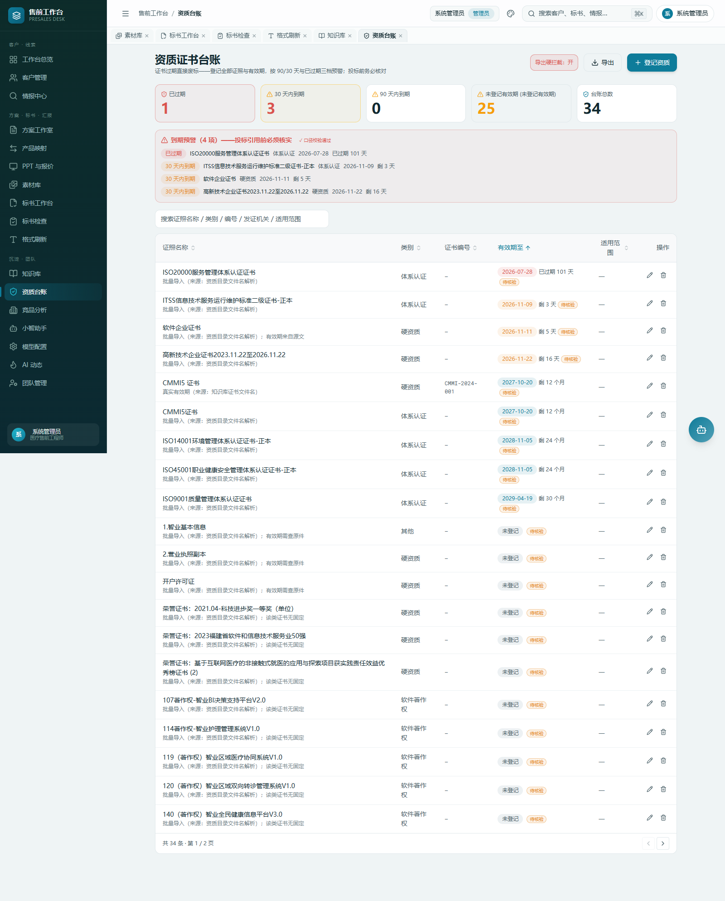

### 现状是什么样

五张统计卡（已过期 1 / 30 天内到期 3 / 90 天内到期 0 / 未登记有效期 25 / 台账总数 34）→ 红色预警条（到期预警 4 项）→ 搜索+筛选 → 34 行证书表格。

### 为什么要优化

**从流程角度**：这是全站**业务价值最扎实的页面之一**（防废标），也是完成度相对较高的页面，但仍有明显短板：
- 五张统计卡中"未登记有效期 25"这个**最行动导向的数字**（25 张证书连有效期都没登记！）视觉上和其他数字完全一样——它应该是红色警报级别
- 预警条列出 4 项，但点击只能跳到台账，**不能直接定位到那一行**——用户还要在 34 行里找

**从布局角度**：
- 表格列宽分配不合理："证书名称"列被挤压换行 2-3 行，而"操作"列两个图标占了固定宽度
- 有效期列的"已过期 101 天""剩 3 天"用了彩色胶囊，这是好的；但"未登记"的灰色胶囊太多（25 个），满屏灰点让真正的警报被稀释

**从操作角度**：编辑/删除两个小图标（约 16px）点击热区太小；无批量操作。

### 优化方向

1. 统计卡按**危险度着色排序**：已过期（红）→ 30 天内（橙）→ 未登记（黄，且文案改为"⚠ 25 张未登记有效期，点击批量补录"）→ 正常（灰绿）
2. 预警条每条带"定位"按钮，点击后表格滚动到该行并高亮闪烁
3. 操作列改为行尾"⋯"菜单（编辑/查看扫描件/续期登记/删除）
4. 增加批量选择与"批量登记有效期"功能（25 个未登记的痛点一键缓解）

### 优化后的结果

风险分层清晰（红橙黄灰四档）；预警可直达行级；25 条未登记数据有批量补救路径。

---

## 十四、竞品分析

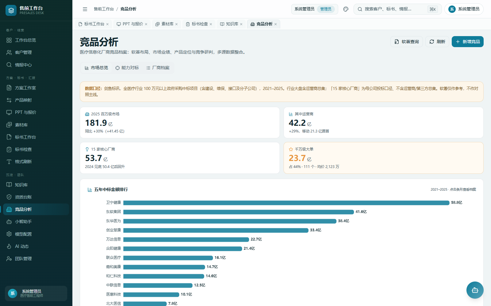

### 现状是什么样

三个 Tab（市场总览/能力对标/厂商档案）→ 数据口径说明条 → 四张市场规模卡（181.9 亿/42.2 亿/53.7 亿/23.7 亿）→ 五年中标金额排行条形图（卫宁健康 58.8 亿居首…）。

### 为什么要优化

**从流程角度**：售前使用竞品分析的典型场景是**应标前**："这个标的竞争对手可能是谁？他们的强项弱项？历史中标价多少？" 现状的"市场总览"回答的是**行业研究问题**（市场规模、运营商份额），而非**应标作战问题**。

**从布局角度**：
- 四张"亿级"大卡是行业宏观数据，与"我该投多少钱"的微观决策距离很远
- 条形图没有交互提示（悬停显示明细？点击进厂商档案？用户不知道）

**从视觉角度**：这是全站数据可视化最专业的页面，但数字单位（亿/万）混用、卡片配色（蓝/绿/黄）与语义没有对应关系。

### 优化方向

1. 增加"应标视角"入口：输入项目名称/医院 → 输出"该院历史中标厂商 Top3 + 价格区间 + 常用参数倾向"（这才是售前要的）
2. 条形图增加交互：悬停显示年度明细，点击进入厂商档案
3. 市场总览降级为第二个 Tab，默认 Tab 改为"厂商档案"（高频）或新增的"应标视角"
4. 数据口径说明条默认折叠

### 优化后的结果

竞品分析从"行业研报"变为"应标参谋"；每个图表可点击钻取。

---

## 十五、小智助手

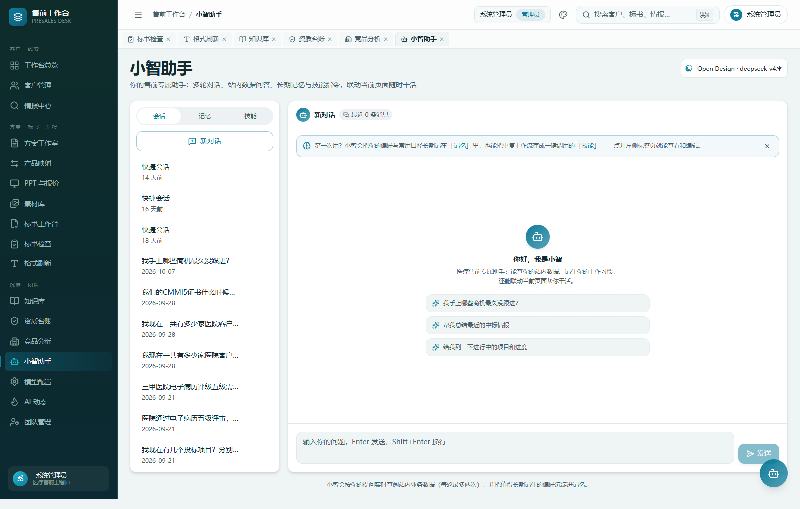

### 现状是什么样

三 Tab（会话/记忆/技能）→ 左侧会话列表 → 右侧对话区（欢迎语 + 三个快捷问题 + 输入框）→ 底部一行能力说明小字。

### 为什么要优化

**从流程角度**：这是对话式 UI，流程本身没问题。问题在于**价值证明不足**：
- 快捷问题（"我手上哪些商机最久没跟进？"）是好设计，但只有 3 个，且不会根据当前页面上下文变化——用户在标书工作台唤起助手时，快捷问题应该变成"这份标书还差几章？"
- 会话列表全是"快捷会话 14 天前"这种**无信息标题**——所有会话看起来一模一样，无法找回历史对话
- "记忆"和"技能"两个 Tab 藏在顶部，大多数用户可能从未点开过——而这恰恰是助手区别于普通聊天框的核心资产

**从布局角度**：左侧会话列表宽度合理，但每条会话只有标题+日期，没有内容预览。

**从操作角度**：输入框提示语（Enter 发送，Shift+Enter 换行）OK，但**没有展示"我能做什么"的能力边界**——用户问了一个答不了的问题就会流失。

### 优化方向

1. 快捷问题**上下文感知化**：随用户所在页面变化（首页问待办、标书页问进度、客户页问跟进）
2. 会话自动命名（用首条问题生成标题）+ 内容预览（鼠标悬停显示最后两条消息）
3. 欢迎页增加"我能帮你做"的能力卡片区（查数据/写文档/做检查/跑流程四类），点击卡片自动填入示例问题
4. "记忆/技能" Tab 在新手期加小红点引导，首次点开后消失

### 优化后的结果

助手从"聊天框"变为"看得见的生产力工具"；会话可检索可复访；新用户知道能问什么。

---

## 十六、模型配置

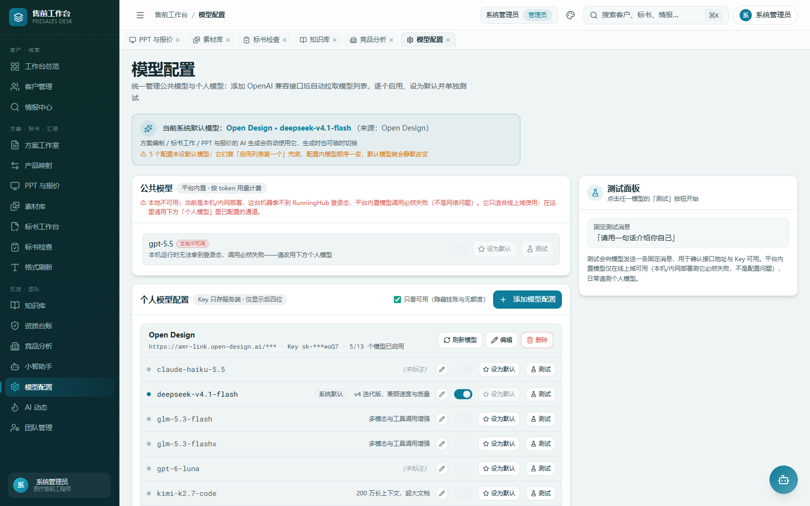

### 现状是什么样

当前默认模型横幅 → 公共模型区（红色警告"本地不可用"）→ 个人模型配置区（Open Design 渠道 + 6 个模型列表，每个带"设为默认/测试"按钮）→ 右侧测试面板。

### 为什么要优化

**从流程角度**：这是典型的**管理员低频配置页**，但现状有两个让人紧张的设计：
- "公共模型 本地不可用"的红色警告条永久悬挂——**这是一个已知且不可解决的环境限制**（本地部署必然拿不到平台内置模型的登录态），它不是错误而是事实，用红色警告呈现会让管理员每次进来都心里一紧
- "5 个配置未设默认模型…默认模型就会静默改变"这句警告的语义过于技术化，普通管理员读不懂后果

**从布局角度**：右侧"测试面板"在用户未点"测试"时是一整块说明文字占位——这块面积可以用来展示"各模型最近调用成功率/平均耗时"这种真正有用的运维数据。

**从操作角度**：6 个模型每行三个操作（编辑/设为默认/测试），密集但尚可；主要问题是"设为默认"这种高影响操作**没有确认和后果提示**（改了默认模型 = 全站 AI 生成行为改变）。

### 优化方向

1. 公共模型区改为**折叠的灰色信息卡**（"线上部署时可用"，默认收起），消除常驻红条
2. "设为默认"增加确认弹窗："将把全站 AI 生成切换到 glm-5.3-flash，原默认 deepseek-v4.1-flash 退为备用"
3. 右侧测试面板升级为"模型健康看板"（各模型最近 24h 调用次数/成功率/平均耗时）
4. 警告文案人话化："如果你没给某个功能单独指定模型，它会自动使用列表里第一个可用的"

### 优化后的结果

配置页从"让人紧张"变为"让人安心"；管理员能看到模型运行状况而非静态列表。

---

## 十七、团队管理

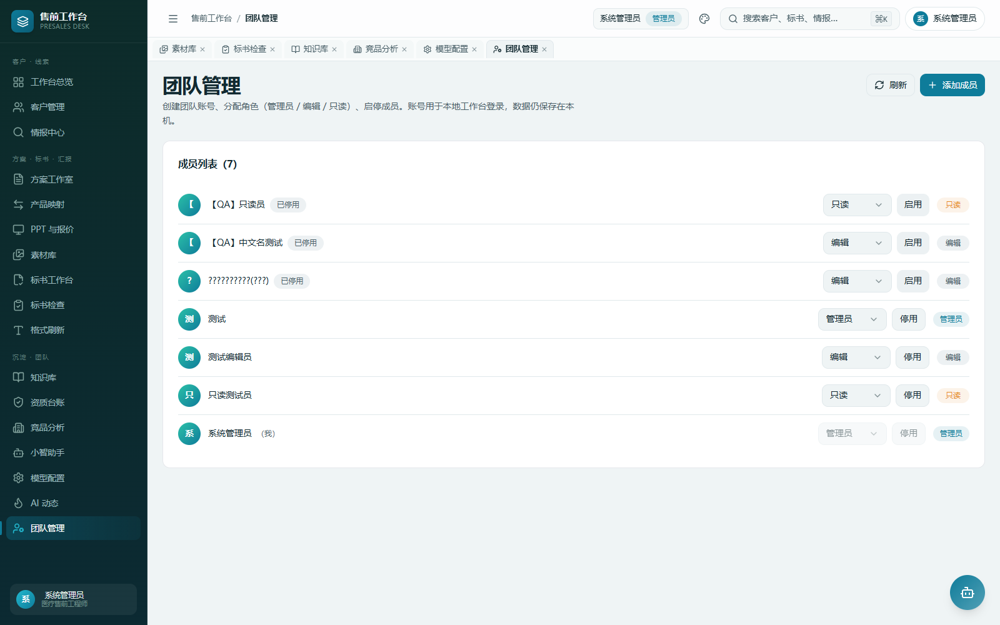

### 现状是什么样

标题 + 说明 → 添加成员按钮 → 成员列表 7 行（头像 + 姓名 + 状态徽章 + 角色下拉 + 启停按钮 + 编辑）。

### 为什么要优化

**从流程角度**：功能简单直接，但细节有刺：
- 列表里出现了"???????????(???)"这种**乱码成员**——说明创建时对特殊字符/编码没有校验和兜底显示
- 【QA】前缀的测试账号与正式成员混在一个列表，没有"测试账号"分组或过滤
- "停用"按钮与"角色下拉"并列，**停用是危险操作（会导致成员无法登录）却没有确认**

**从布局角度**：7 行成员的表格用了大量留白，右侧操作区过宽；"添加成员"按钮位置正确。

**从操作角度**：角色下拉的三个选项（管理员/编辑/只读）**没有权限差异说明**——管理员给成员分配角色时不知道"编辑"和"只读"具体能干什么。

### 优化方向

1. 创建成员时校验特殊字符，显示层做编码兜底
2. 增加"测试账号"标签分组或一键隐藏测试数据开关
3. 停用/启用增加确认弹窗（停用将立即踢出该成员的登录会话）
4. 角色下拉改为带说明的选择弹窗（每个角色配一行权限说明）
5. 增加"最近登录时间"列——管理员一眼看出哪些账号是僵尸账号

### 优化后的结果

账号管理安全可控；测试数据不污染正式视图；角色分配不再靠猜。

---

## 十八、汇总：17 个模块的优化优先级矩阵

按「业务价值 × 改造收益」排序，给出全局实施顺序建议：

| 批次 | 模块 | 核心动作 | 理由 |
|------|------|---------|------|
| **第一批**（已做/在做） | 工作台总览 | 重构（已上线） | 全站门面 |
| | 标书工作台 | 流水线可视化（进行中） | 核心生产链 |
| **第二批** | 资质台账 | 预警分级+批量补录 | 直接防废标 |
| | 客户管理 | 消灭半屏空白+缺失项直达 | 高频入口 |
| | 情报中心 | 双模式+筛选收敛 | 信息入口减负 |
| **第三批** | 标书检查 | 单入口+历史报告 | 工具极简主义 |
| | 小智助手 | 上下文感知+会话可检索 | AI 资产复用 |
| | 素材库 | Tab 收敛+空态引导 | 低成本快赢 |
| **第四批** | 产品映射 | 左右分栏+结果区显性化 | 任务导向重构 |
| | PPT 与报价 | Tab 数据联动+空态主按钮 | 业务解耦 |
| | 方案工作室 | 教学信息折叠 | 老用户降噪 |
| | 竞品分析 | 增加应标视角 | 从研报到参谋 |
| | 模型配置 | 警告降级+健康看板 | 管理员体验 |
| | 团队管理 | 危险操作确认+角色说明 | 安全细节 |
| **减法项** | AI 动态 | 并入情报中心 | 砍掉低价值页面 |
| | 格式刷新 | 文案时机优化 | 已经不错，微调即可 |
| | 知识库 | 搜索合一+引用排序 | 打磨项 |

---

## 十九、设计系统层面的统一规范（所有页面共用）

无论哪批实施，所有页面遵循同一套规则：

```
字号阶梯：28(页面标题) / 20(区块标题) / 16(卡片标题) / 14(正文) / 12(辅助)
色彩语义：红=阻断危险 / 橙=临期警告 / 蓝=进行中信息 / 绿=完成正常 / 灰=次要
间距节奏：卡片间距 16 / 卡片内边距 20 / 区块间距 24 / 页面边距 24
空态四要素：图标 + 一句话说明 + 主行动按钮 + 次要帮助链接
危险操作三件套：红色描边 + 二次确认 + 操作后果一句话说明
长任务反馈：loading（<3s）/ 骨架屏（>3s）/ 进度条（>30s，含可取消）
```

---

**报告结束。** 所有截图存档于 `docs/ux-review-2026-11/shots/`，可对照原图逐条复核。
